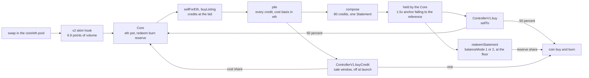

# credits engine

an erc20 on ethereum mainnet whose swap fees buy Credits nfts, compose them into Statements and sell each statement at a falling price. the coin, pool, hook and fee flow run on the artcoins v2 stack (restricted coin, skim hook, lp locker, fee escrow), with the Core as the bounty recipient of the pool. every economic number is an owner setting, effective at once. status: unaudited, not deployed. `main` is the working branch.

## what the engine does

* **fees buy credits.** the v2 hook skims 6.9 points of swap volume. 6.65022 points reach the Core, which owes its payee 0.5 points once the anti sniper window has passed and books the rest into the eth pot (90 percent) and the redeem burn reserve (10 percent). the pot funds a bid, the rate in wei per credit, and every credit is paid the same rate. a seller calls `sellForEth`, or a caller fills a marketplace listing below the bid with `buyListing`. each fill drops the rate, and between fills the rate climbs toward a ceiling. every bought credit enters one pile with a cost basis in eth.
* **credits compose into statements.** `compose()` takes the 80 oldest credits from the pile and mints a Statement. the Core holds it and records its cost, the sum of the 80 cost bases, and its rating, the sum of the credits' scores. `composeChosen(ids, format)` composes 80 credits the caller names with an art format 0 to 7. it is an owner switch (`chosenComposeOn`), off at launch.
* **credits can sell before they compose.** the credit sale window is an owner switch (`creditSaleOn`), off at launch. while on, every pile credit is for sale through `ControllerV1.buyCredit` from its acquisition time. the price falls linearly from a start to a floor over `creditWindow` (4 hours at launch), and the floor is 1.1 times the highest of the credit's cost, its balance token baseline and its score-scaled eth backstop (the floor rate times `max(1, score / refScore)`, where the floor rate is the larger of the climbed eth bid rate and the remembered peak). the baseline reads the live balance token pool and only lifts the floor. the cost share of the proceeds refills the eth pot and the rest funds the coin buyback. compose waits for a credit's window.
* **statements sell at a falling price.** `ControllerV1.buy` sells a held statement. the start price is 1.5 times an anchor (the anchor moves up with sales and decays with time). the price falls fast from the start to the knee, then slowly to the floor. the curve is in percent of the statement's price reference, the larger of its cost and the floor rate (the larger of the climbed eth bid rate and the remembered peak) times its rating over `refScore`. at launch the knee and the floor are both 100 percent of the reference, so the price reaches the reference at hour 50 and an unsold statement sits there.
* **each sale funds a buy and burn.** 50 percent of the proceeds (`saleToBuybackBps`) go to the coin buyback, which swaps eth for the coin in the pool and burns it. the other 50 percent refill the eth pot.
* **the redeem burn reserve.** each redemption of a statement moves 20 percent of the reserve (`redeemBurnBps`) to the buyback, so every statement that leaves the engine, sold or redeemed, funds a buy and burn.
* **the balance side.** the owner sets a balanceModule and switches `balanceMode` from 0 (off) to 1 (hold) or 2 (on). from mode 1, `redeemStatement` redeems a held statement once its curve price has reached its floor. a redemption must return at least `rating * unitPerPoint` of the balanceToken less `redeemSlippageBps`, and the Core keeps what arrives. in mode 2 the Core also buys credits with the balanceToken, per point: `score * unitPerPoint` less `balanceBidMarginBps` (20 percent at launch). such a credit enters the same pile with an eth cost basis of its score-scaled eth backstop (the floor rate times `max(1, score / refScore)`, where the floor rate is the larger of the climbed eth bid rate and the remembered peak), read from no pool, so the bid needs no pool key. once the balanceToken trades, the owner sets its v4 pool key on the controller, and a statement's asking price is at least the higher of its curve price and its redemption value in eth.

the full rules and the settings table are in docs/SPEC.md. the owner decisions behind them are in docs/DECISIONS.md.



## contracts

five contracts are ours. the artcoins v2 stack is live on mainnet (`script/config/v2-mainnet.json`) and enters the engine as a config input (`script/config/mainnet.json`).

| name | role |
|---|---|
| Core | custody and every rule: pots, bid, the pile, doors, compose, `composeChosen`, `sellTo`, `sellCreditTo`, redeem, buyback, settings, owner doors, locks |
| CoreLib | library of the Core called by delegatecall: settings write, bid math, the buyback swap, the balanceToken bid, `adopt`, `rescueCoin`, `rescueNft`, `migrate` |
| ControllerV1 | statement sale: `priceOf`, `buy`, the price reference, the anchor, the pause, the balanceToken pool key for the redemption value floor. credit sale: `creditPrice`, `buyCredit`, `buyCredits` |
| CoreLens | read only view of the Core and the controller in one call |
| ArtCoinsTokenV2 and the v2 stack | the coin and its factory, hook, locker, escrow and anti sniper module (`script/config/v2-mainnet.json`) |

each runtime contract stays under 24,576 bytes (`forge build --sizes`).

## who can call what

| caller | doors |
|---|---|
| anyone | `sellForEth`, `buyListing`, `adopt`, `compose`, `composeChosen` (when open), `sellForBalance` (balanceMode 2), `redeemStatement`, `buyback`, `book`, `fund`, `collectEscrow`, `claimPayee`, `ControllerV1.buy`, `ControllerV1.buyCredit` and `buyCredits` (when the credit sale is on) |
| owner of the Core | `setSettings`, `setRate`, `setController`, `setBalanceModule`, `refreshUnitPerPoint`, `releaseRedeemBurn`, `setCreditCostToPotBps`, `setChosenComposeOn`, `setMinCcToChoose`, `addAdapter`, `removeAdapter`, `rescueCoin`, `rescueNft`, `setSuccessor`, `migrate`, two step `transferOwnership` |
| owner on the controller | the sale settings, `setRefScore`, the credit sale settings (`setCreditSaleOn`, `setCreditWindow`, `setCreditFloorBps`, `setCreditStartBps`), `setAnchorBps`, `setBalancePoolKey`, `setPaused` (blocks `buy` and `buyCredit`, composing, the bid, redemptions and buybacks continue) |
| coin admin (the owner) | `setBountyRecipient` on the hook, `lockRecipients` on the coin |
| locks, one way | `lockController`, `lockBalanceModule`, `lockAdapters`, `lockSuccessor` on the Core |

eth, credits and balanceToken leave the Core at the owner's call only through `migrate` to the successor. coin leaves through `rescueCoin` and NFTs off the books through `rescueNft`. the owner sets the price the engine pays and the balanceModule that redeems statements, so holders trust the owner key (docs/SPEC.md section 10).

## build and test

prerequisites: foundry 1.8.1 and an archive mainnet rpc (drpc.org, mevblocker.io, blastapi.io or tenderly all work).

```sh
git clone --recurse-submodules <repo>
cd credits-engine
cp .env.example .env
set -a; . ./.env; set +a
forge build
forge test --match-path test/Sale.t.sol
```

* tests run on a mainnet fork pinned to block 26158000 (`FORK_BLOCK`) against the live v2 stack. foundry caches fork state on disk, so the first run is slow.
* during work, run `forge build` and `forge test --match-path` on the test files the change touches. the full suite, the deep invariant runs and the rehearsal run once, on a frozen candidate, with `CANDIDATE_RUN=1`.
* the guard `script/tools/guard-forge-test.sh` (a PreToolUse hook in `.claude/settings.json`) refuses a whole-suite `forge test` and any `INVARIANT_DEEP=1` run unless the command carries `CANDIDATE_RUN=1`.
* the production contracts (`src/*.sol`, `src/lib/CoreLib.sol`) and the deploy scripts that use `new` compile with via_ir. tests reach them through `src/interfaces/ICore.sol`, `IControllerV1.sol` and `ICoreLib.sol` (generated by `script/tools/gen-interfaces.sh`, rerun after an abi change) and `test/utils/Prod.sol`. tests import the interfaces and leave `src/Core.sol` and `src/ControllerV1.sol` alone. `test/BuildIdentity.t.sol` pins the shipped build hashes.
* stand ins are in `test/standins/`, attack contracts in `test/attackers/`.
* the simulator runs on node: `node sim/engine.test.mjs`, `node sim/build.mjs`, `node sim/run.mjs q1`.

toolchain notes and timings: docs/STATUS.md section 5.

## deploy

one script, `script/Deploy.s.sol`, deploys the system and launches the coin through the v2 factory, driven by one config file (`script/config/mainnet.json`, copied to the gitignored `script/config/local.json`). the factory owner key signs everything, and `Resume.s.sol` finishes a deploy that stopped half way. read-only `Preflight.s.sol` and `Postflight.s.sol` check the system before and after, and `Lock.s.sol` sends `coin.lockRecipients()` as an owner command after the launch. the owner address is an EIP 7702 delegated account, so broadcasts use `--slow`. the owner decisions in docs/STATUS.md are settled before launch.

the runbook, with the commands in order, is docs/RUNBOOK.md.

## docs

| file | what |
|---|---|
| docs/SPEC.md | the system as built: intent at a glance, settings, rules, owner powers, accepted risks |
| docs/DECISIONS.md | the dated owner decision log |
| docs/STATUS.md | where we are, the packet plan, open items, the freeze table, how to work in this repo |
| docs/RUNBOOK.md | the launch runbook, the parameter sign off table, owner commands after launch |
| docs/INTEGRATION.md | call sequences, events, reverts and gas for integrators and keepers |
| docs/SIMPLIFICATION-v1.md | the simplification review and the packet plan |
| sim/README.md, sim/index.html | the simulator study and the offline simulator |
| docs/reviews/ | independent reviews, rehearsals and acceptances, each pinned to the commit it examined |
| docs/notes/ | reference notes and the bid study |

`script/tools/check-freeze.sh` checks the freeze table of docs/STATUS.md before the deploy step.

## license

MIT. listing purchase checks and twap buyback patterns adapted from tokenworks (MIT).
