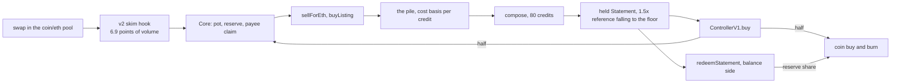

# credits engine

an erc20 on ethereum mainnet (CC) whose trading fees fund a permanent public bid for Credits NFTs. the engine buys Credits at the bid or sweeps cheaper listings, composes 80 into a Statement, sells the Statement at a falling price, and burns CC with half of every sale. when the balance token is live, Statements redeem into it by rating and the engine buys Credits with it by score. the coin and pool run on the live artcoins v2 stack. status: unaudited by humans, launching on the AI run reviews in docs/reviews/, not deployed. the working branch is named in docs/STATUS.md.



## contracts

| name | role |
|---|---|
| Core | custody and every rule: pots, the bid, the pile, compose, sales, fee booking, the pause, buyback, the balance side, owner powers, locks, migrate |
| CoreLib | the Core's linked library, run by delegatecall in the Core's storage |
| ControllerV1 | pricing: the statement curve and anchor, the credit sale, `valueOf`, the royalty |
| SeaportBasicAdapter, CreditStrategyAdapter | read only pricers for `buyListing` |

## who can call what

| caller | doors |
|---|---|
| anyone | `sellForEth`, `buyListing`, `compose`, `composeChosen` (when open), `setHeldFormat` (with 1 CC), `sellForBalance` (when on), `redeemStatement` (when on), `buyback`, `book`, `fund`, `collectEscrow`, `claimPayee`, `adopt`, `ControllerV1.buy`, `buyCredit`, `claimRoyalty` |
| the owner | every setting, the controller, the balance module, the adapters, the successor, the four locks, `migrate`, `rescueCoin`, `rescueNft`, `setPaused`, `setPayee`, the handover |

eth, credits and the balance token leave the Core at the owner's call only through `migrate` to the successor. the owner sets the price the engine pays, so holders trust the owner key (docs/SPEC.md section 11).

## build and test

prerequisites: foundry 1.8.1, an archive mainnet rpc.

```sh
git clone --recurse-submodules <repo>
cd cc
cp .env.example .env            # MAINNET_RPC_URL, FORK_BLOCK=26158000
set -a; . ./.env; set +a
forge build
forge test --match-path test/Sale.t.sol
```

tests run on a mainnet fork against the live v2 stack. during work: `forge build` and `forge test --match-path` on the files touched. the full suite, the deep invariant runs and the rehearsal run once, on a frozen candidate, with `CANDIDATE_RUN=1`; a hook refuses a whole suite run without it. after a forge run: `git checkout foundry.lock; git submodule update -- lib/solady`. the simulator: `node sim/engine.test.mjs`.

## deploy

one script, script/Deploy.s.sol, nine transactions through the deterministic deployer, driven by script/config/mainnet.json copied to the gitignored local.json. the runbook is docs/RUNBOOK.md.

## docs

| file | what |
|---|---|
| docs/SPEC.md | the system as built: intent at a glance, settings, every rule, owner powers, invariants, accepted risks |
| docs/DECISIONS.md | the dated owner decision log; section 11 is the product agreement |
| docs/STATUS.md | where the work stands, the plan, the freeze table, how to work in this repo |
| docs/RUNBOOK.md | the launch, the owner commands after it, recovery |
| docs/INTEGRATION.md | the call surface for keepers and frontends |
| docs/reviews/ | reviews, rehearsals and acceptances, each pinned to a commit |
| docs/notes/ | the market data notes and the bid study |
| sim/README.md | the simulator |

## license

MIT. the buyback swap pattern is adapted from tokenworks (MIT).
