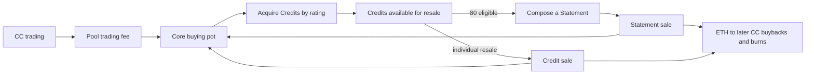

# CC project context

Reviewed against `ripe0x/cc` main at `74558d203918293174cdeebece080a1be1532089`, 2026 10 20.

This is an orientation document for agents working on the product, website, or communications. It explains the artistic context, economic intent, participant experience, and language constraints. It does not supersede `AGENTS.md`, `docs/STATUS.md`, `docs/SPEC.md`, `docs/DECISIONS.md`, the actual contracts, or current onchain settings. Those sources must be checked before stating a live parameter.

## 1. The point of the project

CC is an independent Ethereum coin and acquisition engine built around Jack Butcher's Credits and Statements. Trading the coin feeds a contract controlled ETH pot. The engine makes a standing, rating based offer for Credits, acquires eligible market listings, and assembles eligible groups of 80 Credits into Statements. It can also sell individual Credits. ETH returned through these sales is directed partly to continued acquisitions and partly to CC buybacks and burns.

The mechanism is intended as a continuing market participant, not simply a treasury that buys NFTs and relists them above acquisition price. CC's circulating bid responds to fills, trading revenue replenishes its capacity, and acquired Credits have two paths: individual resale or eventual composition into Statements. Proceeds from either route can finance more acquisitions and coin buybacks. The goal is to keep the cycle responsive to a changing market rather than wait forever for one speculative markup.

**Important limit:** the current resale floors are still anchored to acquisition cost. If market demand drops below those floors, Credit and Statement inventory can remain unsold. The engine can continue placing bids while new fee income creates available ETH, but it cannot promise that every item will clear or that spent capital will return. Public copy must distinguish the goal of sustained motion from a guarantee of perpetual inventory turnover. There is no guarantee that trading activity or a buyback will increase CC's price.

The engine is separate from the artist's project. Do not imply endorsement, partnership, ownership of Jack's IP, or control of the upstream Credits and Statements contracts.

## 2. Backstory worth telling

Primary source: https://jack.art/credits/

Jack Butcher created Credits from eligible $8 payments through X Money. A payment becomes a unique visual artwork: the payment transaction ID is hashed into 256 bits, mapped to cyan, magenta, yellow, and black grids, and selectively displayed using the payment timestamp. Eighties in the source transaction produce visible marks. Credits thus turn payment records into artworks.

Credit ratings: https://jack.art/credits/rating/

The 122,154 original Credits receive scores from 80 to 800 based on rarity of five properties. The score describes rarity, not market value. Jack's Statements contract destroys 80 Credits to mint one Statement. A Statement's rating sums its source Credits' scores. The upstream system also allows later overprinting, with its own rules. CC only uses the basic 80 Credit composition path.

Recommended framing: CC gives the secondary market around these works a persistent, mechanical participant. The artwork and its generative process belong to Jack. The bid and acquisition strategy belong to CC.

## 3. Core cycle

The stream from trading is separate from NFT sale proceeds. A trade does not directly burn CC. A sale earmarks ETH for later buyback execution. The burn amount depends on actual trading depth, slippage, contract execution, and price.

## 4. Participants and motivations

| Participant | What they do | Why they may care |
| --- | --- | --- |
| CC trader | Buys and sells the coin | Speculates on demand and observable engine activity. Pays the pool skim on trades. Has no contractual claim on the ETH pot or its NFTs. |
| Credit holder | Sells Credits to the standing ETH bid | Can exit at a quoted rating based price, without waiting for a specific counterparty to place an offer. |
| Credit buyer | Buys Credits from the engine | May get individual artworks through the engine's descending resale prices, rather than wait for a composition. |
| Statement collector | Buys an assembled Statement | Acquires an artwork containing 80 destroyed Credits through a descending ETH sale. |
| External caller or keeper | Submits compatible listings or triggers composition and buybacks | Can receive bounded gas reimbursement and an incentive when eligible. This is conditional on price gaps, caps, and contract checks. |
| Jack's designated royalty recipient | Receives payment on engine acquisitions and NFT resales | Benefits directly from activity CC creates around the works. |
| Artcoins protocol leg | Receives its share of the trading fee | Receives a defined launch pool fee allocation distinct from artist royalties and CC treasury income. |

## 5. What actually happens

### Acquisition

A holder can sell eligible Credits to `Core.sellForEth` at an ETH bid determined by the Credit's official score. The engine can also buy a compatible listing through the approved CreditStrategy or Seaport adapter using `buyListing`. The marketplace ask must fit at or below the engine's bid. The difference may cover a bounded caller reimbursement and incentive; it is not automatically handed to the seller. ETH buying is limited by available funds, processing reserves, temporary return locks, paused state, and other guards. A displayed bid is not an unconditional fill.

The bid state climbs while the pot can fund another reference sized acquisition and falls after an acquisition. Bigger Credit scores receive proportionally larger ETH bids and cause proportionally scaled drops. The hard cap and the change rates are owner controlled, and the owner can change the rate directly. Never write that the bid only increases or that it guarantees a minimum price for the collection.

### Individual Credit resale

The engine offers held Credits for sale during a configurable window. Their ETH ask declines from a markup toward a cost and value derived floor. This provides a path for Credits to return to collectors instead of only waiting for 80 Credits to be composed. A Credit sold by the engine cannot immediately return through an intake route; the configured return lock follows that Credit through transfers.

**Down market behavior:** new acquisitions lower the bid, and fresh fee income may continue to fund purchases even if older inventory fails to sell. The resale curves do not lower their floors indefinitely. At the current 100 percent cost floor on Statement sales and the cost and value based floor on Credit sales, unsold inventory can accumulate. If the owner wants an unconditional route for selling below historical cost, that requires a separately approved economic change, its loss funding rule, and appropriate safety limits. Do not claim the existing engine has such a route.

### Composition and Statement resale

After eligible Credits have passed their sale window, anyone may trigger composition of a batch of 80 into a Statement. This uses the upstream Statements contract and burns the 80 inputs. The new Statement belongs to the Core and is available for an ETH sale. Its ask begins at a markup to a reference based on costs and values, declines over a configured interval, and rests at its floor. The configured initial markup is 150 percent of reference, but durations and sale parameters are editable and tracked onchain.

The engine's composition is not an exclusive or official means of making Statements. The upstream project allows collectors to compose independently.

### Optional later features

The contracts include a balance token integration, a future balance funded purchase route, redemption, value mode, and optional chosen composition. These are independent switches and upstream dependencies. The coin launch does not require balance token activation. Public explanations should not promise it is active. The repo's current owner decision explicitly defers publishing the balance module reference and its detailed guides without further approval. See `docs/SPEC.md` and `docs/DECISIONS.md` for internal details.

## 6. Economic flows at the tracked launch settings

The following are configuration facts, not immutable promises. The owner can change many Core settings immediately. Trading skim parameters are fixed by the selected pool configuration at launch.

| Activity | Launch allocation or rule | Practical meaning |
| --- | --- | --- |
| CC pool trade after launch window | 6.9 percent of traded volume total skim | 6.21 percent of volume to the CC Core; 0.69 percent to the protocol leg via a 90/10 split of the skim. |
| Opening trading window | 69 percent skim at the start, decaying to 6.9 percent over 69 minutes | Very costly opening trades; the website should expose the current fee and countdown. |
| Buying a Credit with ETH | 2.5 percent of purchase price to the artist on top of the amount the seller receives | Paid by the Core, not deducted from a holder's quoted sale payout. The listing route can also pay its caller. |
| Buying a Credit with the future balance token | 2.5 percent in that currency, on top of the seller amount | Only relevant once that route is activated. |
| Selling a Statement for ETH | 2.5 percent of the gross sale to artist; 0.5 percent to operator; 25 percent of remaining 97 percent to CC buyback; balance to pot | On 100 ETH: artist 2.5 ETH, operator 0.5 ETH, buyback allocation 24.25 ETH, pot 72.75 ETH. |
| Selling an individual Credit | 2.5 percent artist and 0.5 percent operator off gross; up to 80 percent of the Credit's recorded cost to pot, limited by the remainder; any remaining net amount to buyback | Not the same fixed percentage split as a Statement sale. At a low sale price, the buyback part can be zero. |
| CC buyback | ETH in buyback allocation spent in limited periodic swaps, received CC burned | Requires a successful caller and swap; allocations are not immediate burns. |
| Initial coin distribution | 1,000,000,000 CC total supply; no launch extensions; entire minted allocation placed into the initial liquidity position by the Artcoins factory | No presale, creator token allotment, or airdrop is configured in the original launch transaction. The pool liquidity is placed via the Artcoins locker. Do not say the operator received token allocations. |

The 6.9 percent trading skim is separate from any royalties on NFT transactions. In the referenced pool configuration the dynamic fee is the hook skim with zero additional LP swap fee. Do not call 6.9 percent the artist royalty.

## 7. What agents must not imply

1. CC is neither official Credits software nor a collaboration with Jack Butcher.
2. Holding CC does not grant ownership of the pot, redeemability for ETH, governance rights, or entitlement to NFT sale revenues.
3. CC does not automatically burn tokens with each trade. Burning follows funding, NFT sales, buyback scheduling, gas limits, and successful swaps.
4. The engine is neither immutable nor ownerless. The owner may change bids, percentages, sale rules and modules immediately, pause activity, and migrate permitted inventory and ETH to a successor. Relevant locks may narrow these powers later. See `docs/SPEC.md` section 11.
5. A standing bid does not guarantee every Credit can be sold at that moment. Reserve, capital, settings, return lock and execution constraints still apply.
6. Official Credit ratings are measures of rarity, not ETH value or an objective aesthetic ranking.
7. The current website can be unavailable, stale, or delayed because the indexer and RPC services are distinct. Do not present offchain feed freshness as execution certainty.
8. Avoid conflating Credit sales, Statement sales, and CC trades. Each has a different revenue allocation.

## 8. Source of truth and launch status

Agent reading order: `AGENTS.md`, `docs/STATUS.md`, `docs/SPEC.md`, `docs/DECISIONS.md`, `script/config/mainnet.json`, `deployments/1.json`, `src/Core.sol`, `src/ControllerV1.sol`, `script/Builder.sol`, then `web/`.

At this review's main revision the tracked deployment record describes a deployed, configured Core and a predicted but not yet live CC coin. Source: `deployments/1.json`; the latest `docs/STATUS.md` says coin launch still requires separate acceptance. The state may change at any time. Verify onchain before publishing deployment status.

**Known config versus deployment record mismatch:** `script/config/mainnet.json` has `rateStart = 0.0056 ETH per 100 points`, `sale.decayHours = 4`, and `credit.window = 14400` seconds. `deployments/1.json` reports `openingRate = 0.0097 ETH per 100 points`, `controllerDecayHours = 1`, and `controllerCreditWindow = 3600` seconds. The record may reflect later approved onchain owner updates, but do not assume either source is current without a live contract read. The website FAQ intentionally omits those three potentially stale numbers.

Other useful source files: `web/components/Flywheel.tsx` for the current cycle explanation, `web/lib/sale-split.ts` for Statement sale percentages, `web/lib/market.ts` for the fee and hook display, `docs/INTEGRATION.md` for external calls, `keeper/src/decide.ts` for automated purchase policy, and `web/lib/docs-content.ts` for public technical guides.

## 9. Recommended website explanation sequence

1. First screen: one plain sentence that CC trades help an autonomous system acquire Credits, followed by an actual live diagram.
2. Origin: a short introduction to Jack's original Credits and their 80 to one Statement process, linking to jack.art.
3. Mechanism: explain the engine as a continuously responding market participant, with a changing ETH bid and two inventory paths. Describe its down market resilience as an aspiration that depends on fresh funding and actual bids, and acknowledge the present cost floor limitation.
4. Money: one clear visual with the steady trading skim and the Statement sale split. Label artist, Artcoins protocol, operator and CC buyback independently.
5. FAQ: answer practical questions about buying and selling, the bid, fee burden, distribution, royalties, control, and affiliation.
6. Contract docs: leave function names, detailed settings, and full integration reference in `/docs`.

Visual direction: the existing CMYK and IBM Plex Mono vocabulary is appropriate. Use real Credit and Statement art already shown by the site, rather than invented artwork. A fee waterfall and an illustrative bid trace add more clarity than additional illustrations. Make numbers legible on mobile, include plain text for screen readers, and distinguish configured percentages from live ones. Consider linking the FAQ directly below the flywheel on the homepage as well as the footer.

## 10. Copy review standard

Aim for curiosity, economy, and specificity. Explain the distinctive behavior before implementation vocabulary. Avoid generic FAQ entries about wallets, gas, Ethereum, or basic NFT ownership. The project should feel like a visible machine operating in a real market rather than a list of tokenomics claims. State drawbacks and controls without making speculative promises.

Prefer short lower case interface sentences. Do not use dash punctuation in public copy. When editing public copy, use fresh language that conveys intent instead of restating an earlier project description verbatim.
